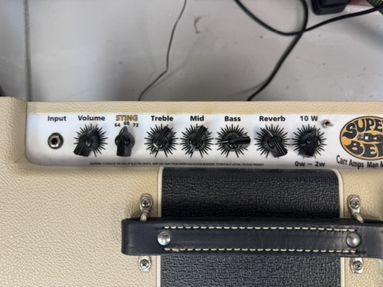
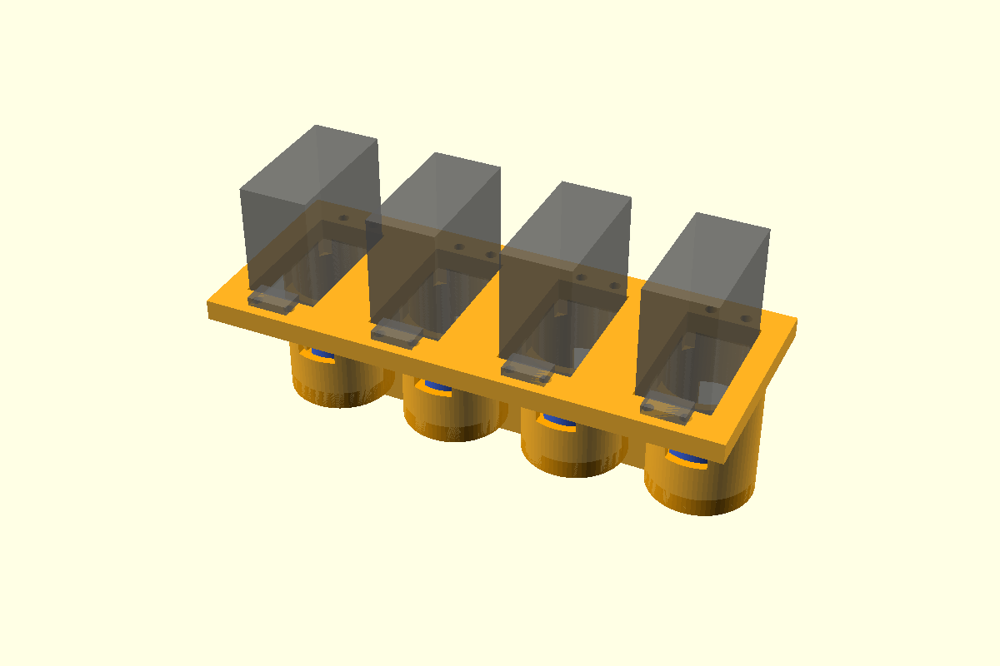

# ampservos

Computer control of the Treble, Mid, Bass and Reverb knobs on a Carr Super Bee,
using four hobby servos driven by a Phidgets RCC1000. Nothing gets drilled into the amp.

 

## How it works

- **Servos:** goBILDA 2000-series Dual Mode Servo, set to servo mode: 300° over 500–2500 µs,
  which matches the pots' 300° travel, and gives absolute position with no homing.
- **Frame** (`part="frame"`): one printed bridge. Under each servo is a tube whose
  bottom slips over a printed collar on that pot's mounting nut (`part="collars"`), so the four
  nuts locate the frame coaxially and stop it from rotating. The bore is wider than the couplers
  all the way down, so the frame lifts straight off without tools. The servos hang upside down, splines pointing down.
- **Couplers** (`part="couplers"`): 3-piece Oldham couplers, so the servo and the pot don't
  have to line up perfectly. The pot hub grips the 1/4" shaft with M3 set screws
  (two, 90° apart, in brass heat-set inserts), which you reach through a slot in the tube. The servo hub screws to the
  20 mm aluminum disc horn on the servo.
- **Electronics:** VINT hub → RCC1000 (16-channel RC servo Phidget) set to 6 V servo
  power, or an older 1061 AdvancedServo 8-Motor on USB. Channels 0–3 = treble, mid, bass, reverb.
- **Software:** `ampservos.py` engages each servo only while it moves, then releases it.
  The pot's friction holds the setting, and the amp never hears PWM chatter or a servo hunting.

## Parts list

Besides the printed frame, couplers and nut collars. Prices are rough.

### Electronics (Phidgets)

| Qty | Part | Notes | ~Price |
|---|---|---|---|
| 1 | **RCC1000** 16× RC Servo Phidget | Drives all four servos on channels 0–3 | $30 |
| 1 | **HUB0000** VINT Hub Phidget (USB) | Or HUB5000 for network; skip if you have a free VINT port | $30 |
| 1 | VINT / Phidget cable | Hub to RCC1000; usually included, get a longer one if needed | $3 |
| 1 | USB cable for the hub | | — |
| 1 | 12 V 2 A DC supply for the RCC1000 | Check the RCC1000 spec page for its input range | $15 |

**Alternative:** an older **PhidgetAdvancedServo 8-Motor (1061)** works in place of the RCC1000,
hub and cable. Its pulses go to 2.7 ms, so the full 300° is available. Servo power is fixed at
5 V, which is within the goBILDA's 4.8–7.4 V range. It takes 6–15 V in, so the same 12 V supply
works, and it connects straight to USB. Set `CONTROLLER = "1061"` in `ampservos.py`.

### Servos

| Qty | Part | Notes | ~Price |
|---|---|---|---|
| 4 (+1 spare) | **goBILDA 2000-0025-0002** Dual Mode Servo (25-2 Torque) | 300° in servo mode over 500–2500 µs. **Not** the 5-turn 2000-0025-0502, which spreads ~1800° over the same pulses. Not on Amazon: buy from [goBILDA](https://www.gobilda.com/2000-series-dual-mode-servo-25-2-torque/), [ServoCity](https://www.servocity.com/2000-series-dual-mode-servo-25-2) or [RobotShop](https://www.robotshop.com/products/servocity-2000-series-dual-mode-servo-25-2-torque). | $37 ea |
| 4 | Servo extension cables, 300 mm | Only if the leads don't reach; route away from the input jack | $2 ea |

### Hardware

| Qty | Part | Used for |
|---|---|---|
| 8 (+spares) | M3 × 6 cup-point set screws | Two per pot hub, 90° apart, onto the 1/4" shaft; longer ones stick out into the tube clearance |
| 24 (+spares) | M3 × 4 brass heat-set inserts (4.2 mm knurl) | 16 in the frame's top face for the servo ears, 8 in the pot hubs (pressed down to the step, 1.5 mm below the surface) |
| 4 | M3 × 5 brass heat-set inserts | Ends of the 1061 board studs |
| 16 | M3 × 8 socket-head bolts + M3 washers | Servo ears to the frame inserts |
| 4 (+1) | 19.8 mm aluminum 25T disc servo horns, 4 × M3 tapped holes on a 14 mm circle | Instead of the servo's plastic horn; the model is sized for this one (2.45 mm disc, 9 mm boss, 4.5 mm overall) |
| 8 | M3 × 6 button-head screws | Coupler hub up into the horn's tapped holes |
| 4 | M3 × 8 bolts | 1061 board up into the stud inserts (the M3 × 20 bolts and spacers that come with the 1061 aren't used) |
| — | Thin felt or rubber pads (optional) | Under the tube bottoms to protect the panel |
| — | Velcro strap or Command strips (optional) | Only if the frame rocks |

Each servo comes with a round disc horn, other arms, the M3 horn screw, and self-tapping
screws with rubber grommets and brass eyelets for the mounting ears. None of those are used: the ears bolt
into inserts, and the model uses a 20 mm aluminum horn rather than the included plastic one. Leave the grommets out: a rigid mount holds position better.
(goBILDA's 1906 aluminum hub is 32 mm across and won't fit between 34.7 mm-spaced shafts.)

### Tools

Calipers, heat-set insert tool with an M3 tip, 1.5 mm hex key (M3 set screws), 2.5 mm hex key (M3 socket heads).

Print `part="coupon"` first (about 1 h): five M3 insert holes from 3.7 to 4.1 mm, labeled on top, and
one nut collar. Set `insert_d` (3.9 mm on a Prusa MK3S in PETG) to the hole where an insert goes in straight and holds without bulging the
wall, and check that the collar sits snugly on a pot nut. The guitar logo cut into the coupon's underside
shows how the one on the frame's board shelf will print, since both are on the bed face.

**Rough total:** $260–300.

## Before printing: measure these

Edit the `MEASURE` values at the top of `amp_servo_mount.scad`:

| parameter | what |
|---|---|
| `pitch` | shaft center-to-center spacing (measured: 1.366" = 34.70 mm) |
| `nut_af`, `nut_h` | pot nut size across flats, and nut + washer height |
| `bushing_top`, `shaft_top` | heights above the panel, with the knobs removed |
| `horn_*` | set for a 19.8 mm aluminum 25T horn (14 mm M3 hole circle). Change them if you use a different horn. (Servo dims are from the goBILDA drawing.) |

Start with a fit test in PETG: one coupler set (`part="couplers"` makes four sets, so print one of each
piece) and `part="test_station"`, a single tube cut from the frame. Check that a collar fits snugly on the pot nut,
the tube slips over it, the servo holes line up, the coupler turns freely, and the set screw is reachable.

Then: `openscad -o stl/frame.stl -D 'part="frame"' amp_servo_mount.scad` (and the same for `couplers` and `collars`).

The 1061 board hangs component-side down, under a shelf on the side away from the servo bodies.
Its lowest parts sit about 24 mm above the panel, and the shelf reaches about 75 mm from the
shaft line. Check that there's room for this on your amp. Set `board = false` to leave the shelf off.
The set-screw windows face the servo-body side.

Slice with the MK3S PETG settings in `slicer/petg_mk3s.ini` (0.20 mm QUALITY, Prusament PETG,
4 perimeters, 40% infill, no supports):
`PrusaSlicer --export-gcode --load slicer/petg_mk3s.ini stl/frame.stl --output gcode/ampservo-frame_PETG.gcode`.
Slice the couplers with `--fill-density 100% --fill-pattern rectilinear` so the plastic around the hub inserts is solid. About 9.5 h for the frame and 4 h for the four coupler sets. Each servo opening goes straight through
the plate and opens into the set-screw slot (with a rounded 60° flare where they meet), so there are no long
bridges; the slot ends are teardrops pointed at 60°, and the plate edges are chamfered. Supports aren't needed. Because the opening is open, a servo can go in from above
with its horn and coupler hub already screwed on.

Print in **PETG or ASA**, not PLA: the top panel of a tube amp gets warm.
Print the frame plate-down, and the collars lip-down.

## Use

```
pip install -r requirements.txt
./ampservos.py --calibrate treble     # repeat for each channel; writes calibration.json
./ampservos.py treble=6 mid=4.5 bass=7 reverb=2
./ampservos.py --park                # all knobs to 5, before lifting the frame off
```

Calibrate before anything else. These servos have far more torque than the pots
need, and driving a servo into a pot's end stop will stall the servo or strip the pot.
Record knob 0 and knob 10 a few degrees inside each stop.

## Removing and refitting

The frame is held on by gravity and the four nut collars, and the couplers separate by lifting, so no tools
are needed. The collars and pot hubs stay on the amp.

1. `./ampservos.py --park`: all knobs go to 5.
2. Unplug USB and power, then lift the frame straight up. The servo-side hubs stay on the horns.
   Take the loose middle discs off. The pot hubs stay on the shafts and work as small knobs, and
   the groove on each one points like the original knob did.
3. To refit, turn each pot hub's pointer to 5, drop the discs on, and lower the frame. Wiggle a pot hub
   slightly if a disc doesn't drop into place.

The Oldham tongues are off-center, so each joint goes together only one way round. The coupler can't
end up a half-turn out, which would send a servo into the pot's end stop. Calibration still holds
after refitting, as long as the set screws and horns haven't been disturbed.

When fitting a pot hub the first time, turn the pot fully counterclockwise and set the hub's pointer
where the chickenhead pointed at 0.

## Notes

- Keep the servo wiring away from the input jack and route it out the back.
- The servo system makes no electrical connection to the amp; keep it that way (plastic couplers isolate the pot shafts).
